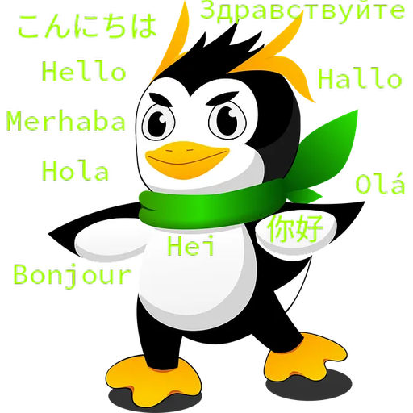

# LinuxDeepl

LinuxDeepl ist ein DeepL-Übersetzer für Linux mit grafischer Oberfläche und Sprachausgabe.



## Was ist LinuxDeepl?

LinuxDeepl ist ein DeepL-Übersetzer für Linux mit grafischer Oberfläche. Die App nutzt die DeepL-API, um Texte zwischen vielen Sprachen zu übersetzen. Sie läuft als Flatpak auf jedem Linux-System mit Flatpak-Unterstützung und erscheint in der GNOME-Software.

## Funktionen

- Übersetzung zwischen über 30 Sprachen (DeepL-API)
- Automatische Spracherkennung
- Sprachausgabe für Eingabe und Übersetzung (nutzt die System-Sprachausgabe)
- Kontingent-Anzeige (verbleibende Zeichen der aktuellen Periode)
- Sprachen und Texte bleiben beim Neustart erhalten
- API-Key wird einmalig gespeichert
- Flatpak-Installation über eigenes, GPG-signiertes Repository

## Installation

### Über das Flatpak-Repository (empfohlen)

```bash
flatpak remote-add --user linuxdeepl https://RigRiver.github.io/LinuxDeepl/linuxdeepl.flatpakrepo
flatpak install --user linuxdeepl de.rig.LinuxDeepl

Direkt als .flatpak-Datei
Lade die aktuelle LinuxDeepl.flatpak von der Release-Seite herunter und installiere sie:

flatpak install LinuxDeepl.flatpak

API-Key
LinuxDeepl benötigt einen DeepL-API-Key. Beim ersten Übersetzen wirst du danach gefragt. Einen kostenlosen Developer-Key (1.000.000 Zeichen, einmalig) bekommst du hier:

https://www.deepl.com/de/developers

Wichtig: Der Key endet auf :fx (Free-Plan). Ein Translator-Abo (Web/Desktop) funktioniert hier nicht.

Sprachausgabe
Die Sprachausgabe nutzt die System-Sprachausgabe (Speech Dispatcher). Standardmäßig klingt sie roboterhaft (espeak-ng). Für natürliche Stimmen kann Pied installiert werden — ein kleines Werkzeug, das Piper (neuronale Sprachausgabe) einrichtet:

https://github.com/Elleo/pied/releases

Nach der Installation von Pied und einer Stimme (z. B. „Karlsson" für Deutsch) klingt die Ausgabe deutlich natürlicher.

Getestet auf Deutlichkeit
Die Sprachausgabe wurde systematisch auf Verständlichkeit geprüft — besonders bei den Lauten, die in der Praxis Probleme machen:

„ch" (ich-Laut vs. ach-Laut)

„sch"

Wortfolge und Betonung

Die gewählte Stimme (Karlsson) hat sich dabei als deutlich und natürlich erwiesen.

Technisches
Sprache: C++ / Qt6

GUI: Qt Widgets (mainwindow.ui)

Netzwerk: QNetworkAccessManager (asynchron)

Sprachausgabe: QTextToSpeech (Speech Dispatcher)

Verteilung: Flatpak mit GPG-signiertem Repository auf GitHub Pages

Metadaten: AppStream-Metainfo (valide)

Lizenz
GPL-3.0-or-later

Autor
RigRiver — alias Rig + Deek


